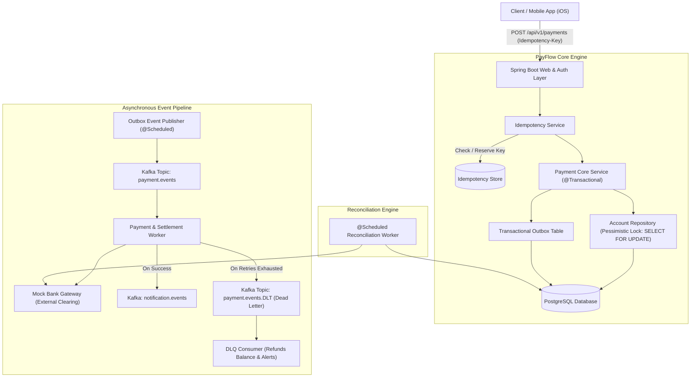

# PayFlow — Distributed Payment Processing Platform

[](https://openjdk.org/projects/jdk/21/)
[](https://spring.io/projects/spring-boot)
[](https://kafka.apache.org/)
[](https://www.postgresql.org/)
[](LICENSE)

A high-throughput, fault-tolerant payment processing backend simulation built with **Java 21** and **Spring Boot 3**. Designed specifically to solve the core challenges of distributed financial systems: **idempotent API execution**, **concurrency control without race conditions**, **reliable messaging via the Transactional Outbox Pattern**, and **automated ledger reconciliation**.

---

## Architecture Overview



---

## Key Engineering Highlights

### 1. Zero Double-Spending Concurrency Control
* Amateurs simply execute `account.setBalance(balance - amount)`, leading to race condition overdraws.
* **PayFlow** utilizes **Row-Level Pessimistic Locking** (`SELECT ... FOR UPDATE` via JPA `@Lock(LockModeType.PESSIMISTIC_WRITE)`).
* Under simultaneous requests, transactions acquire an exclusive row lock on the sender account, preventing double-spending.
* Verified by automated stress tests firing 10 concurrent requests simultaneously.

### 2. End-to-End Idempotency (Mobile-Resilient)
* Unstable mobile networks often drop connections *after* the server has charged an account, prompting the mobile client to retry.
* PayFlow requires or checks an `Idempotency-Key` header:
  * **In-Progress:** If a duplicate arrives while processing, returns `409 Conflict`.
  * **Completed:** If a duplicate arrives after completion, instantly returns the cached `201 Created` response without re-executing ledger operations.
  * Atomic key reservation prevents race conditions at the database level.

### 3. Transactional Outbox Pattern
* Solves the dual-write problem: publishing to Kafka inside an active `@Transactional` block can lead to phantom events if the database transaction rolls back, or lost events if Kafka fails.
* Payment creation and Outbox event persistence occur within the same ACID transaction.
* An asynchronous publisher polls `outbox_events` and reliably streams events to Kafka.

### 4. Dead Letter Queue (DLQ) & Self-Healing
* Transient gateway timeouts are retried with exponential/fixed backoff.
* Messages exceeding max retries are routed to `payment.events.DLT`.
* The `DeadLetterQueueConsumer` safely reverts account deductions and alerts operations.

### 5. Automated Ledger Reconciliation
* A background cron worker (`@Scheduled`) inspects orphaned `PROCESSING` transactions older than 1 minute, queries the bank gateway, and reconciles state drift.

---

## Tech Stack

* **Language:** Java 21 (Records, Pattern Matching, Switch Expressions)
* **Framework:** Spring Boot 3.3.4
* **Security:** Spring Security 6 with Stateless JWT Bearer Tokens
* **Database & ORM:** PostgreSQL 16, Spring Data JPA, Hibernate
* **Event Streaming:** Apache Kafka (KRaft mode)
* **API Documentation:** OpenAPI 3 / Swagger UI (`springdoc-openapi`)
* **DevOps & CI/CD:** Docker, Docker Compose, GitHub Actions
* **Testing:** JUnit 5, Mockito, Testcontainers, Spring MockMvc

---

## Quickstart & Local Setup

### Prerequisites
* Java 21 or newer (Temurin recommended)
* Docker & Docker Compose (optional, for full containerized stack)

### 1. Clone & Build
```bash
cd payflow
./mvnw clean test
```

### 2. Run the Full Stack with Docker Compose
```bash
docker compose up -d
```
This spins up PostgreSQL (`5432`), Kafka (`9092`), Redis (`6379`), and PayFlow (`8080`).

### 3. Run Standalone (Using local or embedded profile)
```bash
./mvnw spring-boot:run
```

---

## API Testing Guide

### 1. Register a Customer (Auto-provisions $1,000 balance)
```bash
curl -X POST http://localhost:8080/api/v1/auth/register \
  -H "Content-Type: application/json" \
  -d '{
    "email": "alice@example.com",
    "password": "password123",
    "fullName": "Alice Smith",
    "initialCurrency": "USD"
  }'
```
*Save the returned `token` from the response.*

### 2. Register a Recipient
```bash
curl -X POST http://localhost:8080/api/v1/auth/register \
  -H "Content-Type: application/json" \
  -d '{
    "email": "bob@example.com",
    "password": "password123",
    "fullName": "Bob Jones",
    "initialCurrency": "USD"
  }'
```

### 3. Check Account Balance
```bash
curl -X GET http://localhost:8080/api/v1/accounts/me \
  -H "Authorization: Bearer <ALICE_TOKEN>"
```

### 4. Initiate an Idempotent Payment Transfer
```bash
curl -X POST http://localhost:8080/api/v1/payments \
  -H "Authorization: Bearer <ALICE_TOKEN>" \
  -H "Idempotency-Key: mobile-tx-550e8400-e29b-41d4-a716-446655440000" \
  -H "Content-Type: application/json" \
  -d '{
    "destinationAccountNumber": "<BOB_ACCOUNT_NUMBER>",
    "amount": 150.00,
    "currency": "USD"
  }'
```
*Re-running the exact same command with the same `Idempotency-Key` returns the cached response with zero double-deductions!*

### 5. Interactive Swagger UI
Open your browser at:
```
http://localhost:8080/swagger-ui.html
```

---

## How to Feature PayFlow on Your Resume

```markdown
**PayFlow — Distributed Payment & Ledger Platform** | *Java 21, Spring Boot 3, PostgreSQL, Kafka, Docker*
• Architected a high-concurrency payment processing engine in Java 21 and Spring Boot 3, enforcing strict ACID transactional integrity using pessimistic row-level locking (SELECT FOR UPDATE).
• Implemented an idempotent payment API layer using unique request keys and DB constraints, eliminating duplicate charges caused by mobile client network retries.
• Resolved dual-write data inconsistencies between PostgreSQL and Kafka by establishing the Transactional Outbox Pattern with a background event dispatcher.
• Designed asynchronous payment settlement consumers with exponential backoff retries and Dead Letter Queue (DLQ) routing for poisoned messages.
• Built an automated ledger reconciliation worker to resolve state drift between external mock bank gateways and internal transaction records.
• Formulated concurrency stress test suites validating zero race conditions across 10+ simultaneous balance transfer threads.
```
