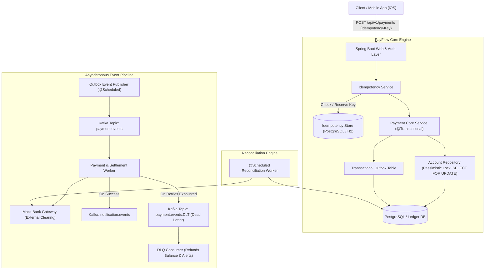

# PayFlow — Distributed Payment & Ledger Platform

<div align="center">

[](https://github.com/Saatvik3006/payflow/actions)
[](https://openjdk.org/projects/jdk/21/)
[](https://spring.io/projects/spring-boot)
[-231F20?style=flat&logo=apachekafka&logoColor=white)](https://kafka.apache.org/)
[](https://www.postgresql.org/)
[](https://www.docker.com/)
[](LICENSE)

**A resilient, event-driven payment processing engine designed to solve the core challenges of distributed financial systems: race-condition overdraws, network retry deduplication, the dual-write problem, and ledger reconciliation.**

[Architecture](#architecture--system-design) • [Engineering Tradeoffs](#architectural-tradeoffs-matrix) • [Interactive Dashboard](#interactive-fintech-dashboard) • [Quickstart](#quickstart--running-locally) • [API Specs](#api-reference) • [Stress Testing](#concurrency-stress-testing)

</div>

---

## Architecture & System Design



---

## Architectural Tradeoffs Matrix

| Challenge | Naive / Tutorial Approach | PayFlow Production Solution | Trade-off & Why It Matters |
| :--- | :--- | :--- | :--- |
| **Concurrency & Double-Spending** | `account.setBalance(bal - amt)` in basic transaction | **Row-Level Pessimistic Locking** (`SELECT ... FOR UPDATE` via JPA `@Lock(LockModeType.PESSIMISTIC_WRITE)`) | Pessimistic locking acquires an exclusive row lock at the database engine level. Prevents thread race conditions and guarantees an account balance can never drop below zero. |
| **Dual-Write Data Loss** | Publishing to Kafka inside a Spring `@Transactional` block | **Transactional Outbox Pattern** with polling publisher | Solves the dual-write problem. Database state updates and event records commit atomically in the same ACID boundary. Guarantees zero phantom events or message loss if the broker blinks. |
| **Network Retries** | Processing every HTTP POST blindly | **Unique `Idempotency-Key` Header** + In-Flight Locks + Cache | Mobile clients on subway tunnels or weak Wi-Fi often retry dropped requests. In-flight duplicates receive `409 Conflict`, while completed payments instantly return the cached `201`/`200` payload with zero duplicate balance deductions. |
| **Poisoned Messages & Outages** | Infinite consumer retries blocking topic partitions | **Dead Letter Topic (DLT)** with Fixed/Exponential Backoff | Prevents "head-of-line" blocking. Poisoned settlement messages exceeding max retries are rerouted to `payment.events.DLT`, where a dedicated consumer initiates a compensating balance refund. |
| **State Drift & Orphaned TXs** | Manual operator database patching | **Automated Scheduled Reconciliation Worker** | An asynchronous cron scans `PROCESSING` payments older than 1 minute, queries external bank clearing networks, and reconciles state drift automatically. |

---

## Interactive Fintech Dashboard

PayFlow ships with an integrated, ultra-modern dark-mode web dashboard accessible at:

👉 **`http://localhost:8088/`**

<div align="center">

| Feature | Visual Demonstration |
| :--- | :--- |
| **One-Click Persona Switcher** | Instantly toggle between **Alice (Sender)**, **Bob (Recipient)**, and **Admin (Ops)** with live JWT token swapping and balance cards. |
| **Simulate Retry Storm (Double Tap)** | A dedicated demonstration button that sends **two simultaneous concurrent HTTP requests with the exact same `Idempotency-Key`** to visually verify real-time deduplication. |
| **Live Immutable Ledger** | Displays realtime transaction references (`PAY-...`), counterparties, currency formatting, and state pills (`SETTLED`, `PROCESSING`). |
| **Chaos & Operations Center** | Live Outbox event counters, Dead Letter Queue (DLQ) inspection, and manual trigger for the reconciliation cron. |

</div>

---

## Quickstart & Running Locally

### Option 1: Standalone Instant Run (No Docker Required)
You can boot PayFlow in **30 seconds** using the embedded local profile:

```bash
git clone https://github.com/Saatvik3006/payflow.git
cd payflow

# Run with local profile (embedded H2 database, zero dependencies)
./mvnw spring-boot:run -Dspring-boot.run.profiles=local
```
* **Modern Dashboard:** [http://localhost:8088/](http://localhost:8088/)
* **Swagger UI Documentation:** [http://localhost:8088/swagger-ui.html](http://localhost:8088/swagger-ui.html)
* **Embedded Database Console:** [http://localhost:8088/h2-console](http://localhost:8088/h2-console) *(JDBC URL: `jdbc:h2:mem:payflow_db`, User: `sa`, Password: empty)*

---

### Option 2: Full Production Stack via Docker Compose
To run with PostgreSQL 16, Apache Kafka (KRaft mode), and Redis 7:

```bash
docker compose up -d
```

---

## Concurrency Stress Testing

PayFlow includes automated multi-threaded concurrency integration tests verifying database lock semantics under high contention.

```bash
./mvnw test
```

### The 10-Thread Contention Test (`PessimisticLockingIntegrationTest`)
* An account is initialized with **\$500.00**.
* **10 concurrent threads** are coordinated with `CountDownLatch` and fired **at the exact same millisecond**, each attempting to withdraw **\$100.00**.
* **Result:** Exactly **5 requests succeed**, exactly **5 requests are rejected** with `InsufficientFundsException`, and the final balance is verified at **exactly \$0.00** with zero race-condition overdraw.

```
[INFO] Tests run: 5, Failures: 0, Errors: 0, Skipped: 0
[INFO] ------------------------------------------------------------------------
[INFO] BUILD SUCCESS
[INFO] ------------------------------------------------------------------------
```

---

## API Reference

All protected endpoints accept a standard `Authorization: Bearer <TOKEN>` header.

| Method | Endpoint | Access | Description |
| :--- | :--- | :--- | :--- |
| `POST` | `/api/v1/auth/register` | Public | Register user & auto-provision starter account (\$1,000) |
| `POST` | `/api/v1/auth/login` | Public | Authenticate user & issue signed JWT bearer token |
| `GET` | `/api/v1/accounts/me` | Customer | Retrieve accounts and live balances for current user |
| `POST` | `/api/v1/accounts/{id}/deposit`| Customer | Atomically deposit funds to account |
| `POST` | `/api/v1/payments` | Customer | **Initiate transfer** (Accepts `Idempotency-Key` header) |
| `GET` | `/api/v1/payments/{ref}` | Customer | Query payment details and status by reference |
| `GET` | `/api/v1/payments` | Customer | Query paginated payment history |
| `POST` | `/api/v1/admin/reconciliation/run` | Admin | Manually trigger background ledger reconciliation |
| `GET` | `/api/v1/admin/outbox/status` | Admin | Inspect counts of `PENDING`, `PUBLISHED`, and `FAILED` outbox events |
| `GET` | `/api/v1/admin/dlq/events` | Admin | Inspect Dead Letter Queue (DLQ) records |

---

## Postman Collection

A pre-configured Postman collection is included in [`postman/PayFlow_Collection.json`](postman/PayFlow_Collection.json). It includes dynamic environment variables and an automated pre-request script that auto-generates UUID `Idempotency-Key` headers.

---

## Project Structure

```
payflow/
├── .github/
│   ├── workflows/ci.yml                   # Automated CI build & test pipeline
│   └── pull_request_template.md           # Standard PR template
├── docker-compose.yml                     # Multi-container stack (Postgres, Kafka, Redis)
├── Dockerfile                             # Multi-stage container build
├── pom.xml                                # Dependencies & plugins
├── postman/PayFlow_Collection.json        # 1-click Postman API collection
├── README.md                              # Project documentation
└── src/
    ├── main/
    │   ├── java/com/payflow/
    │   │   ├── config/                    # Security, JWT, Kafka, Jackson, Swagger
    │   │   ├── controller/                # REST API controllers
    │   │   ├── dto/                       # Modern Java 21 records
    │   │   ├── entity/                    # JPA Entities (Account, Payment, Outbox, etc.)
    │   │   ├── exception/                 # Custom exceptions & GlobalExceptionHandler
    │   │   ├── kafka/                     # Event producers, consumers, and DLT handlers
    │   │   ├── repository/                # Spring Data JPA with @Lock(PESSIMISTIC_WRITE)
    │   │   └── service/                   # Core payment, idempotency, and reconciliation logic
    │   └── resources/
    │       ├── static/index.html          # Interactive Fintech Web Dashboard
    │       ├── application.yml            # Production config (PostgreSQL, Kafka)
    │       └── application-local.yml      # Standalone local config (Embedded H2)
    └── test/java/com/payflow/
        ├── concurrency/                   # Multi-threaded race condition tests
        ├── controller/                    # MockMvc HTTP idempotency integration tests
        └── service/                       # Mockito service unit tests
```

---

## License

Distributed under the Apache 2.0 License. See [`LICENSE`](LICENSE) for details.
